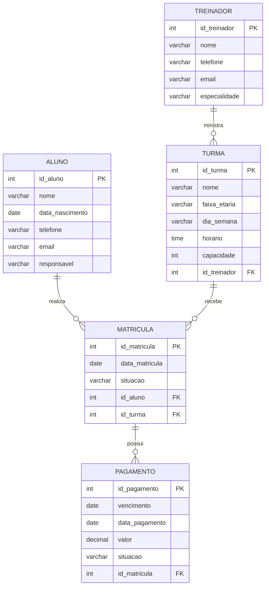

# Base para DER, MER e Modelo Lógico Relacional

## Entidades
ALUNO, TREINADOR, TURMA, MATRICULA e PAGAMENTO.

## Relacionamentos e cardinalidades
- TREINADOR **ministra** TURMA: TREINADOR (0,N) — TURMA (1,1).
- ALUNO **realiza** MATRICULA: ALUNO (0,N) — MATRICULA (1,1).
- TURMA **recebe** MATRICULA: TURMA (0,N) — MATRICULA (1,1).
- MATRICULA **possui** PAGAMENTO: MATRICULA (0,N) — PAGAMENTO (1,1).

## Modelo lógico
- aluno(**id_aluno** PK, nome, data_nascimento, telefone, email, responsavel)
- treinador(**id_treinador** PK, nome, telefone, email, especialidade)
- turma(**id_turma** PK, nome, faixa_etaria, dia_semana, horario, capacidade, *id_treinador* FK)
- matricula(**id_matricula** PK, data_matricula, situacao, *id_aluno* FK, *id_turma* FK, UNIQUE(id_aluno,id_turma))
- pagamento(**id_pagamento** PK, vencimento, data_pagamento, valor, situacao, *id_matricula* FK)

## DER em Mermaid (referência visual)

