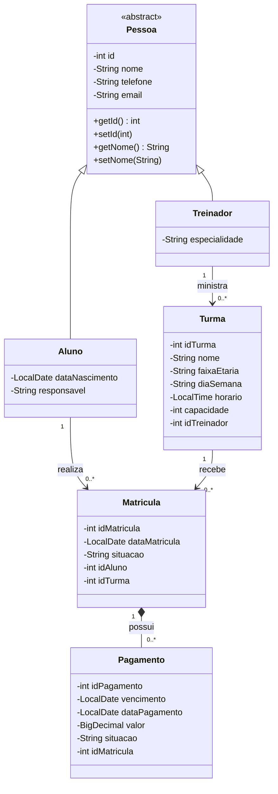

# Diagrama de Classes UML — Base

A generalização foi representada pela classe abstrata `Pessoa`, da qual `Aluno` e `Treinador` herdam atributos comuns. As associações do domínio seguem o banco: Treinador–Turma, Aluno–Matricula, Turma–Matricula e Matricula–Pagamento.

