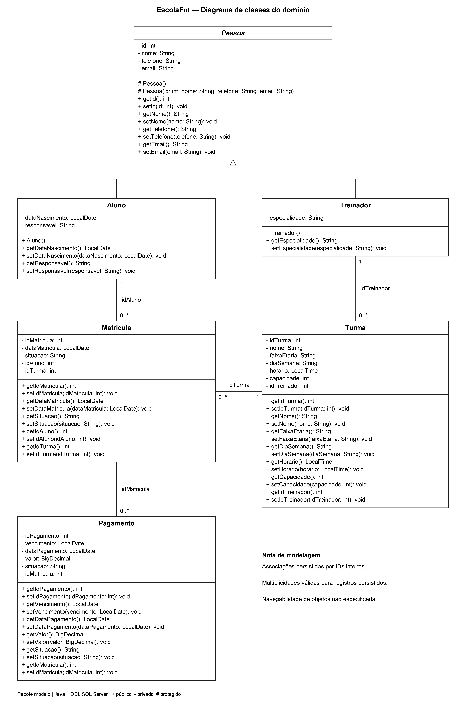

# EscolaFut — Sistema de Gerenciamento de Escola de Futebol

Aplicação desktop acadêmica para organizar as principais rotinas administrativas de uma escola de futebol. O sistema permite manter os registros de alunos, treinadores, turmas, matrículas e pagamentos em uma interface Java Swing, com persistência em Microsoft SQL Server por meio de JDBC.

O projeto foi desenvolvido para praticar programação orientada a objetos, interfaces gráficas, operações CRUD e modelagem de banco de dados relacional.

## Funcionalidades

- **Alunos:** cadastro, consulta, edição e exclusão de registros.
- **Treinadores:** manutenção dos dados dos profissionais e suas especialidades.
- **Turmas:** controle de faixa etária, dia, horário, capacidade e treinador responsável.
- **Matrículas:** associação de alunos a turmas e controle da situação da matrícula.
- **Pagamentos:** registro de vencimento, data de pagamento, valor e situação do pagamento.
- **Interface desktop:** menu principal e telas de gerenciamento feitas com Java Swing (`JFrame`, campos de texto, botões e tabelas).
- **Persistência relacional:** operações SQL via JDBC e `PreparedStatement`, com chaves primárias, chaves estrangeiras e restrições definidas no banco.

## Tecnologias

- Java 21
- Java Swing (`JFrame`)
- JDBC
- Microsoft SQL Server
- Microsoft JDBC Driver for SQL Server 13.6.0
- Maven (`pom.xml`) e configuração para Apache NetBeans

## Organização do projeto

```text
EscolaFut/
├── database/
│   └── escola_futebol.sql       # Criação do banco, tabelas e dados de demonstração
├── documentacao/                # Especificação, modelo lógico e diagramas
├── lib/                         # Driver JDBC do SQL Server
├── src/
│   ├── conexao/                  # Conexão com o banco
│   ├── controle/                 # Menu e telas Swing
│   ├── dao/                      # Consultas e operações CRUD
│   └── modelo/                   # Classes do domínio
├── nbproject/                    # Configuração do projeto no NetBeans
├── build.xml                     # Build do NetBeans/Ant
├── pom.xml                       # Configuração Maven
└── README.md
```

### Arquitetura em camadas

O fluxo principal da aplicação é:

`Tela Swing (controle) → DAO → Conexao/JDBC → SQL Server`

As classes em `modelo` representam os dados do domínio. As classes em `dao` concentram os comandos SQL, enquanto `conexao/Conexao.java` administra a conexão JDBC.

## Modelo de domínio

O banco mantém os seguintes relacionamentos principais:

- Um treinador pode ser responsável por várias turmas.
- Uma matrícula relaciona um aluno a uma turma.
- Um aluno não pode ter duas matrículas para a mesma turma, conforme a restrição de unicidade do banco.
- Cada pagamento pertence a uma matrícula.
- Restrições no banco validam, entre outros pontos, a capacidade da turma, a situação de matrículas e pagamentos, e o valor não negativo dos pagamentos.



## Pré-requisitos

Antes de executar o sistema, instale ou configure:

1. **JDK 21**.
2. **Microsoft SQL Server** (por exemplo, SQL Server Express) em execução e acessível pela aplicação.
3. **SQL Server Management Studio (SSMS)** ou outra ferramenta capaz de executar o script SQL.
4. **Apache NetBeans** ou **IntelliJ IDEA**.
5. O driver `lib/mssql-jdbc-13.6.0.jre11.jar`, já incluído nesta distribuição.

O login usado pela aplicação precisa ter permissão para conectar-se ao SQL Server e ler e gravar na base `EscolaFutebol`.

## Configurar o banco de dados

1. Inicie o serviço do SQL Server.
2. Abra o arquivo [`database/escola_futebol.sql`](database/escola_futebol.sql) no SSMS.
3. Execute o script em uma base nova/vazia. Ele cria a base `EscolaFutebol`, as cinco tabelas (`Aluno`, `Treinador`, `Turma`, `Matricula` e `Pagamento`) e inclui um treinador e um aluno para demonstração.
4. Confirme que a base e as tabelas foram criadas antes de iniciar o aplicativo.

**Atenção:** o script verifica se a base existe, mas as instruções `CREATE TABLE` não recriam tabelas existentes. Não execute o script novamente sobre uma base que já contenha essas tabelas sem antes avaliar o estado do banco.

## Configurar a conexão

A aplicação obtém as credenciais de variáveis de ambiente, evitando deixar a senha diretamente no código.

| Variável | Obrigatória? | Finalidade |
|---|---|---|
| `ESCOLAFUT_SQLSERVER_USER` | Sim | Login SQL Server utilizado pela aplicação |
| `ESCOLAFUT_SQLSERVER_PASSWORD` | Sim | Senha desse login |
| `ESCOLAFUT_SQLSERVER_URL` | Não | URL JDBC; se omitida, usa o endereço padrão abaixo |

URL padrão:

```text
jdbc:sqlserver://localhost:1433;databaseName=EscolaFutebol;encrypt=true;trustServerCertificate=true
```

Se a instalação usar uma instância nomeada ou uma porta diferente, defina `ESCOLAFUT_SQLSERVER_URL` com a URL JDBC adequada. Por exemplo, para uma instância local chamada `SQLEXPRESS`:

```text
jdbc:sqlserver://localhost;instanceName=SQLEXPRESS;databaseName=EscolaFutebol;encrypt=true;trustServerCertificate=true
```

No Windows, adicione as três variáveis nas variáveis de ambiente do usuário e reinicie a IDE para que ela receba os novos valores. A URL de exemplo com `trustServerCertificate=true` destina-se a configurações locais de desenvolvimento; em ambientes de produção, configure e valide corretamente o certificado TLS do servidor.

**Segurança:** nunca publique a senha real, nem a inclua em arquivos versionados, prints ou documentação do repositório.

## Executar a aplicação

### IntelliJ IDEA

1. Abra a pasta do projeto que contém o arquivo `pom.xml`.
2. Configure o **Project SDK** como JDK 21 e aguarde a sincronização do Maven.
3. Confirme que o arquivo do driver está presente em `lib/mssql-jdbc-13.6.0.jre11.jar`.
4. Configure as variáveis de ambiente de conexão e reinicie a IDE.
5. Abra `src/controle/MenuPrincipal.java` e execute o método `main` da classe `controle.MenuPrincipal`.

Consulte também [`README_INTELLIJ.md`](README_INTELLIJ.md) para orientações específicas do IntelliJ.

### Apache NetBeans

1. Abra a pasta do projeto no NetBeans como projeto Java existente.
2. Selecione o JDK 21 nas configurações do projeto.
3. Confirme que o driver JDBC está no classpath.
4. Configure as variáveis de ambiente antes de abrir/reiniciar o NetBeans.
5. Execute o projeto, cuja classe principal é `controle.MenuPrincipal`.

## Documentação adicional

- [`INTERFACE_ACADEMICA.md`](INTERFACE_ACADEMICA.md) — componentes Swing e organização da interface.
- [`documentacao/01_ESPECIFICACAO_PARTE_2.md`](documentacao/01_ESPECIFICACAO_PARTE_2.md) — estudo de caso e requisitos.
- [`documentacao/02_DER_E_MODELO_LOGICO.md`](documentacao/02_DER_E_MODELO_LOGICO.md) — diagrama entidade-relacionamento e modelo lógico.
- [`documentacao/03_UML_BASE.md`](documentacao/03_UML_BASE.md) — referência de modelagem UML.
- [`database/escola_futebol.sql`](database/escola_futebol.sql) — estrutura do banco de dados.

## Escopo

Esta versão é uma aplicação desktop para fins acadêmicos e de demonstração. Não inclui portal web, aplicativo móvel nem integração real com serviços bancários ou fiscais. Para uso em produção, seriam necessários requisitos adicionais de segurança, testes, gestão de configuração e operação.
